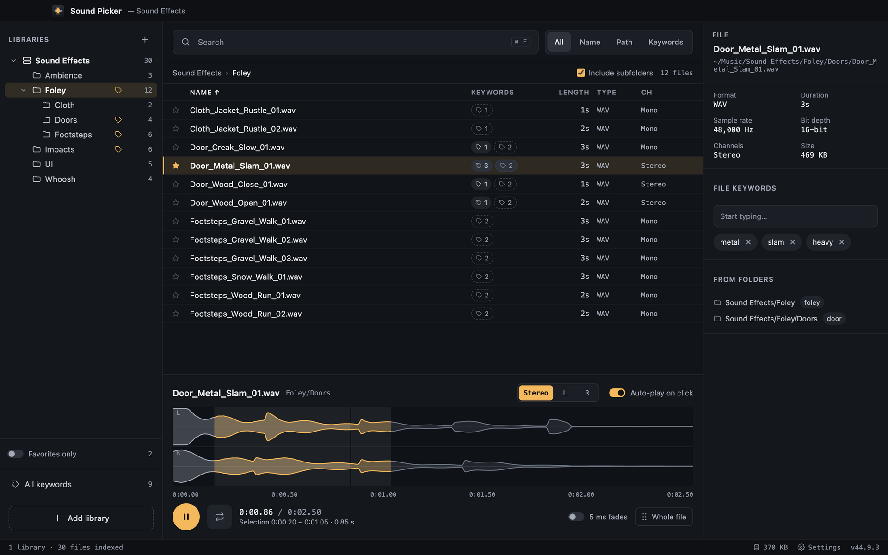
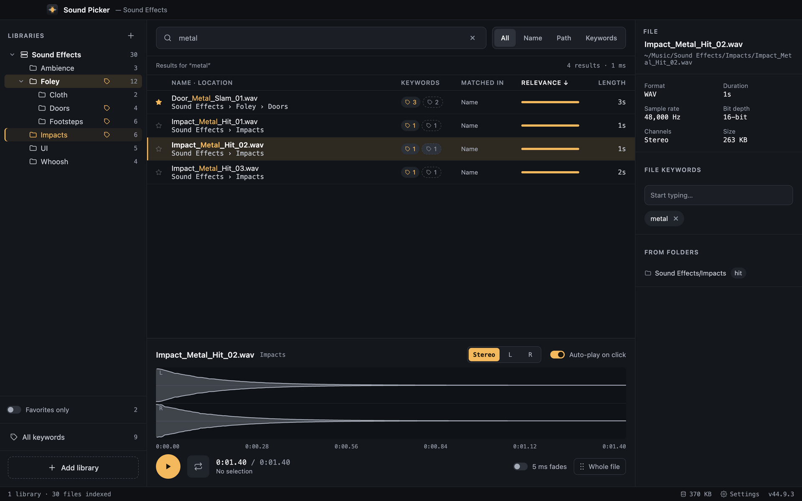
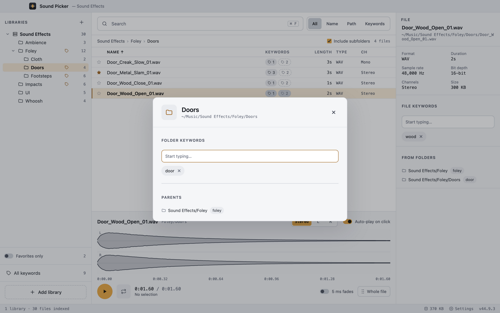

# Sound Picker

A fast browser for your local sound effects library on Windows and macOS. Find a sound, listen in one click, and drag the whole file or just a fragment into your editor, DAW or any other app.

Your sounds stay where they are: Sound Picker only indexes them, it never copies, moves or uploads anything.

## Features

- **Libraries** — add any folder with `.wav` and `.mp3` files and browse it as a tree.
- **Search** across all libraries by name, path or keyword, typo-tolerant. Type `mono` or `stereo` to filter by channels.
- **Player** — waveform, loop, solo the left or right channel.
- **Drag out** a file, or select a range on the waveform and drag just that fragment.
- **Keywords** for files and folders; a folder's keywords apply to everything inside it.
- **Favorites**, light and dark theme, rescan when the library changes on disk.

## Install

Download the latest version from [Releases](../../releases).

- **Windows**: `SoundPicker-Setup-<version>.exe` (installer) or `SoundPicker-Portable-<version>.exe`. If SmartScreen warns you, click **More info → Run anyway**.
- **macOS**: `SoundPicker-<version>-mac-arm64.dmg` for Apple Silicon, `-mac-x64.dmg` for Intel. The app is not notarized: open it once, then click **Open Anyway** in **System Settings → Privacy & Security**. If macOS says the app is damaged, run `xattr -cr "/Applications/Sound Picker.app"` in Terminal.

## Shortcuts

`Ctrl+F` / `⌘F` search · `↑` `↓` move through the list · `Space` play or pause · `1` `2` `3` stereo / left / right · `F5` rescan

## License

Public domain, under [The Unlicense](LICENSE). Use it at your own risk. The bundled MP3 encoder, [lamejs](https://github.com/zhuker/lamejs), keeps its LGPL-3.0 license.
